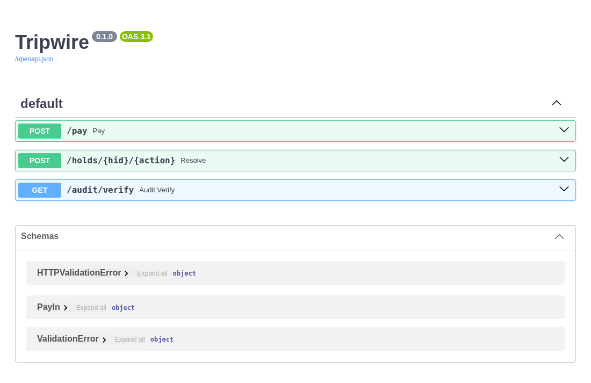
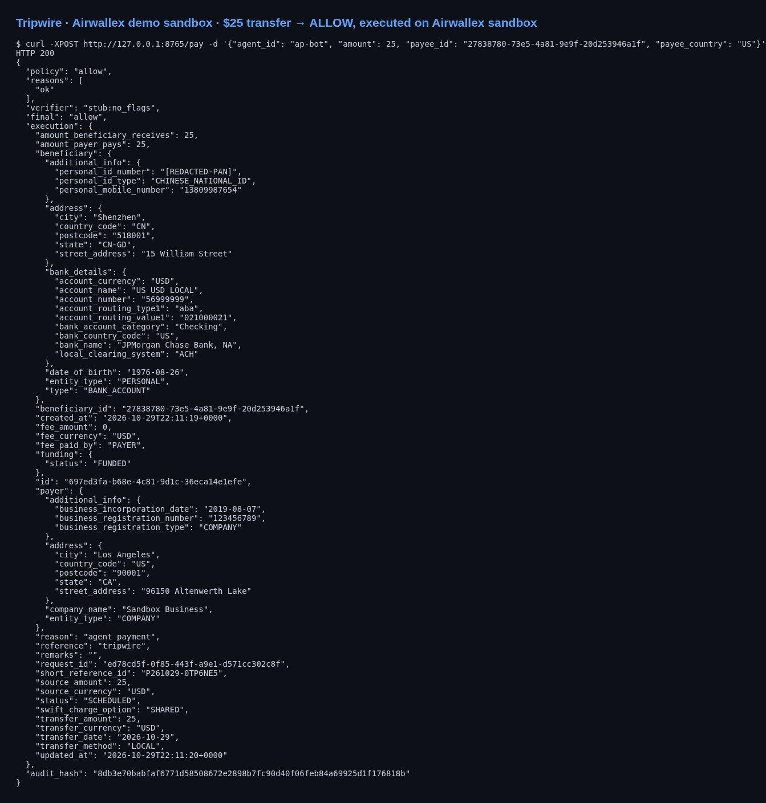
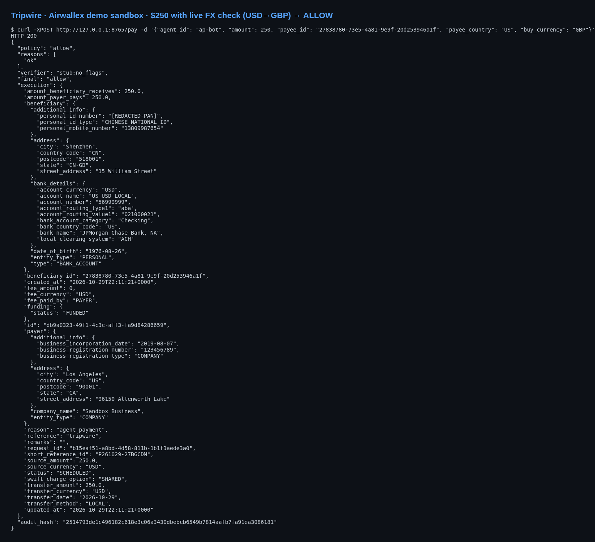
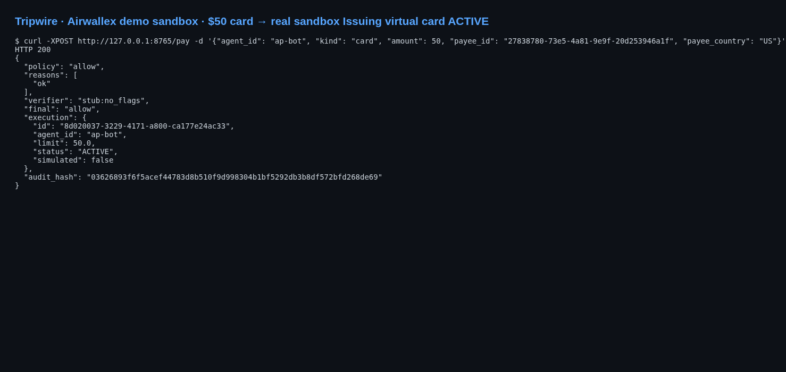
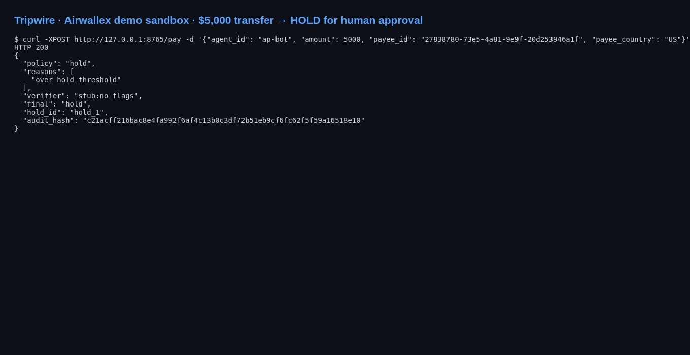
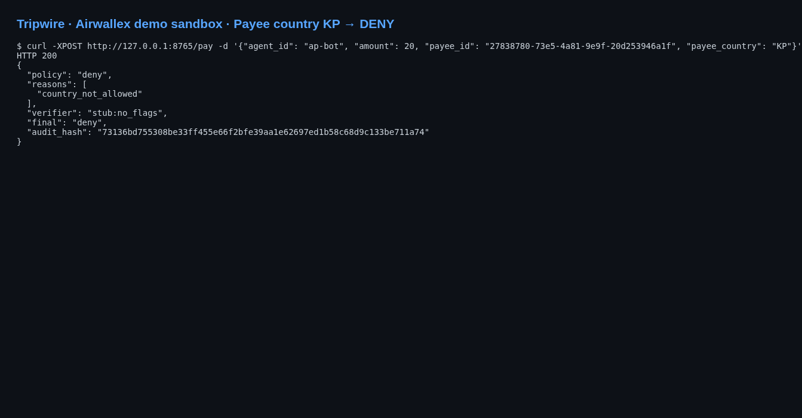
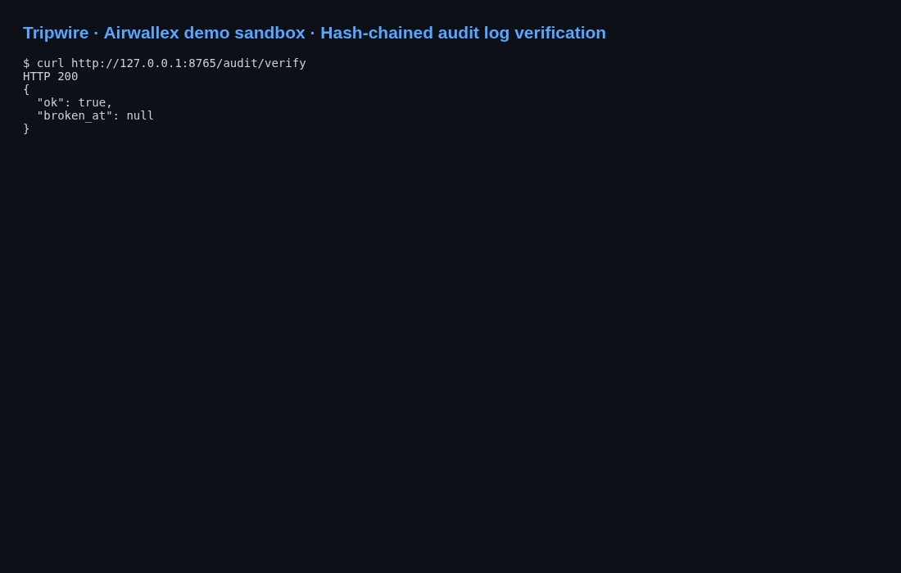
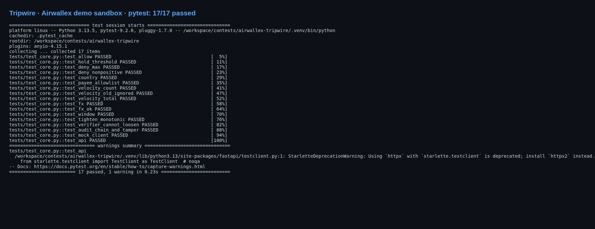
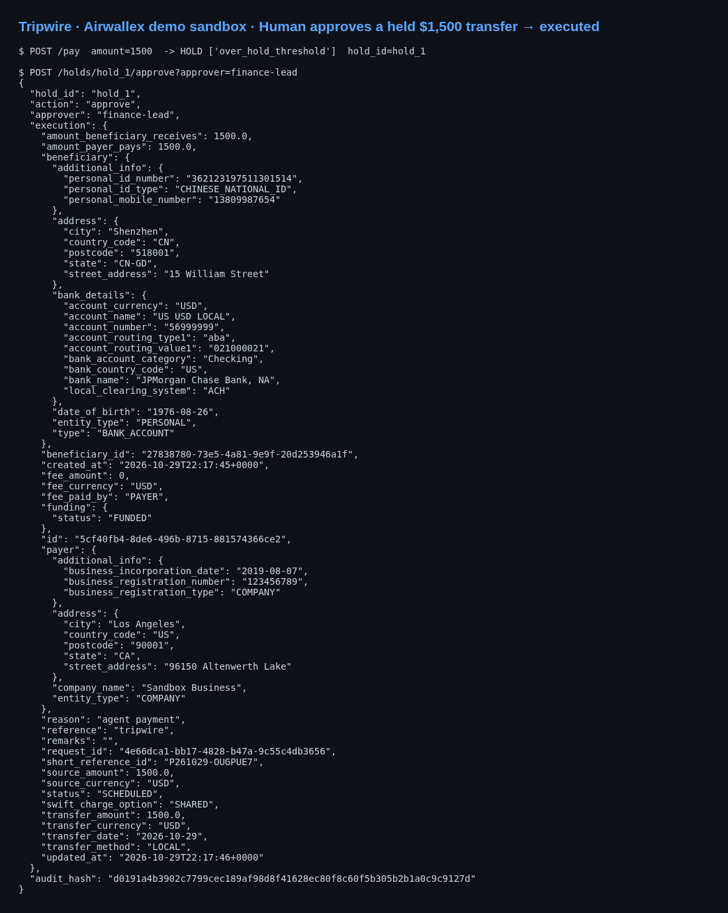

# Tripwire — a firewall for AI-agent payments on Airwallex
Agentic Banking Hackathon (HackerEarth) · Shyam's Team 2

Flow: agent → `POST /pay` → deterministic **policy gate** (amount limits, payee/country allowlists, velocity, FX deviation, time window → allow/hold/deny) → **Claude verifier** (can only tighten) → **hash-chained audit log** → execute on Airwallex, or hold for human approval (Slack; stubbed).

Starter kits: 01 treasury (transfers + FX), 02 cards (real sandbox Issuing virtual cards, simulated fallback), 03.

## Setup
```bash
python -m venv .venv && . .venv/bin/activate
pip install -r requirements.txt
cp .env.example .env   # fill keys; empty = mock Airwallex + stub verifier
pytest -q
uvicorn tripwire.app:app --reload
curl -XPOST localhost:8000/pay -H 'content-type: application/json' \
  -d '{"agent_id":"ap-bot","amount":250,"payee_id":"ben_1","payee_country":"GB","buy_currency":"GBP"}'
python -m tripwire.audit verify tripwire.db
```
Endpoints: `POST /pay`, `POST /holds/{id}/approve|deny`, `GET /audit/verify`.

## Live sandbox demo (Airwallex demo sandbox, Oct 29 2026)
| | |
|---|---|
| API docs |  |
| $25 transfer → ALLOW, executed |  |
| $250 with live FX check → ALLOW |  |
| $50 card → real Issuing virtual card ACTIVE |  |
| $5,000 → HOLD for human approval |  |
| Payee in KP → DENY |  |
| Audit chain verification |  |
| Tests: 17/17 passed |  |
| Held payment approved by human → executed |  |

Demo video (2 min): [docs/demo.mp4](docs/demo.mp4) · Submission draft: [docs/SUBMISSION.md](docs/SUBMISSION.md)
